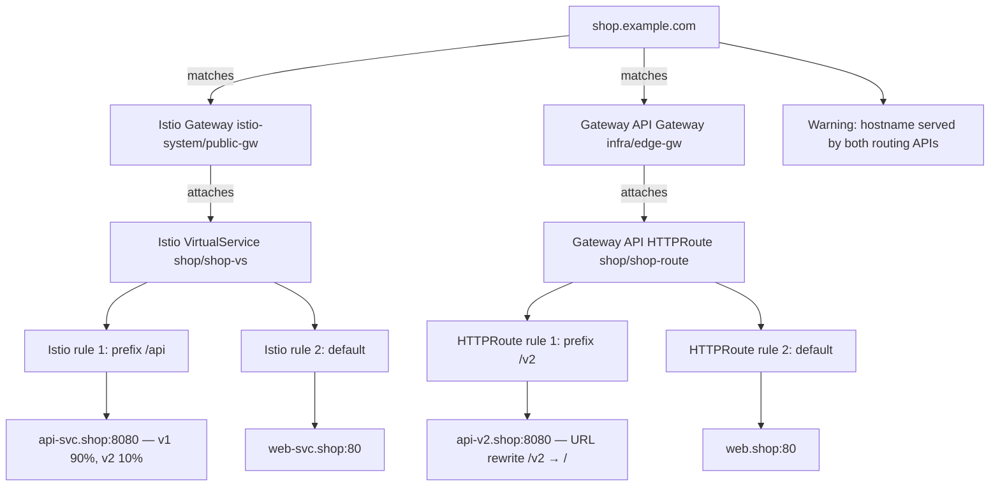

# istio-route

`istio-route` is a read-only command-line tool that traces hostnames through Istio
and Kubernetes Gateway API configuration, showing matching entry points, routes,
rules, destinations, and actionable findings. It also tests expected routing
behavior against rendered manifests with Gherkin feature files; see
[Test rendered routing behavior](#test-rendered-routing-behavior).

For a hostname, it follows the configuration chain from Gateway/listener through
matching routes and rules to backend Services and their ready endpoints and Pods.
It can analyze either live cluster resources or local manifests, and reports
missing API families and route problems instead of silently hiding them.

## Example trace

The default text output makes the route chain and mixed routing API findings easy
to scan:

```text
shop.example.com
├─ [Istio] Gateway istio-system/public-gw server https :443 HTTPS (TLS SIMPLE, secret shop-tls)
│  └─ [Istio] VirtualService shop/shop-vs
│     ├─ [Istio] 1. prefix /api
│     │  ├─ [Istio] → api-svc.shop:8080 subset v1 (90%)
│     │  └─ [Istio] → api-svc.shop:8080 subset v2 (10%)
│     └─ [Istio] 2. (default)
│        └─ [Istio] → web-svc.shop:80 (100%)
└─ [Gateway API] Gateway infra/edge-gw listener https :443 HTTPS ✔ Programmed
   └─ [Gateway API] HTTPRoute shop/shop-route ✔ Accepted ✔ ResolvedRefs
      ├─ [Gateway API] 1. path prefix /v2 header x-canary=true
      │  ├─ [Gateway API] filter: URLRewrite path=/v2 → /
      │  └─ [Gateway API] → api-v2.shop:8080 (100%)
      └─ [Gateway API] 2. (default)
         └─ [Gateway API] → web.shop:80 (100%)
⚠ shop.example.com is served by both an Istio VirtualService and a Gateway API HTTPRoute
```

The same relationships can be rendered as a Mermaid diagram:

<details>
<summary>Show the routing diagram</summary>



</details>

## Install

Download and verify the Linux amd64 release archive (replace `0.1.0` with the
release version and `linux_amd64` with your platform):

```sh
set -euo pipefail
VERSION=0.1.0
ARCHIVE="istio-route_${VERSION}_linux_amd64.tar.gz"
RELEASE_URL="https://github.com/ninoamine/istio-route/releases/download/v${VERSION}"

curl -fLO "${RELEASE_URL}/${ARCHIVE}"
curl -fLO "${RELEASE_URL}/checksums.txt"
grep "  ${ARCHIVE}$" checksums.txt | sha256sum --check
tar -xzf "$ARCHIVE" istio-route
sudo install istio-route /usr/local/bin/istio-route
```

For other platforms, choose the matching archive from the
[GitHub releases](https://github.com/ninoamine/istio-route/releases) page.

## Build from source

Building from source requires Go 1.27 or newer.

```sh
go build -o istio-route ./cmd/istio-route
```

## Inspect offline manifests

Pass one or more files with `-f`/`--file`. Each file can contain multiple YAML
documents. Offline mode reads only those files and does not initialize a Kubernetes
client:

```sh
./istio-route -f testdata/manifests/istio.yaml shop.example.com
./istio-route -f testdata/manifests/istio.yaml \
  -f testdata/manifests/gateway-api.yaml shop.example.com
./istio-route -f testdata/manifests/mixed.yaml --output json shop.example.com
```

The examples under [`testdata/manifests/`](./testdata/manifests/) are intentionally
small and safe to inspect. `missing-reference-grant.yaml` demonstrates a rejected
cross-namespace reference; `endpoints.yaml` includes a Service, EndpointSlice, and
Pod for endpoint inspection.

## Audit a Gateway

The `analyze` subcommand audits one Gateway API Gateway or Istio ambient waypoint.
It accepts the Gateway name and its namespace, and can read local manifests or a
live cluster:

```sh
./istio-route analyze -f testdata/manifests/gateway-audit-healthy.yaml \
  -n infra edge
./istio-route analyze -f testdata/manifests/gateway-audit-overlap.yaml \
  -n infra --output json edge
./istio-route analyze --context staging --namespace infra \
  --output yaml edge
```

Use `-f`/`--file` to analyze only the supplied manifests; `-f -` reads one YAML
stream from stdin. Without manifest files, the current kubeconfig context is used.
Use `--kubeconfig` and `--context` to select live-cluster credentials and context.
`--namespace` overrides the kubeconfig namespace and is required for live analysis
when the context has no default namespace. The command supports `text`, `json`,
`yaml`, and `mermaid`; `--no-color`, `NO_COLOR`, and redirected stdout disable text
styling.

The live audit is read-only. It gets the selected Gateway and GatewayClass, lists
HTTPRoutes and GRPCRoutes to filter matching parent references, and reads only
referenced backend, grant, EndpointSlice, and waypoint-selection data. The reader
RBAC in [`deploy/rbac.yaml`](./deploy/rbac.yaml) adds only `get`/`list` access for
Gateway and GatewayClass objects and `list` access for GRPCRoutes, Namespaces, and
EndpointSlices; it does not grant Secret access or write operations.

The command exits `0` for a clean audit, `4` when findings are reported, `3` when
the requested Gateway is absent, `2` for invalid usage, and `1` for runtime, source,
or parsing errors. The literal root hostname `analyze` is reserved for this
subcommand; other hostname arguments retain the existing trace behavior.

### Route rule precedence

When two rules that share a listener and have intersecting hostnames overlap, the audit decides which
rule wins by comparing each rule's best match, in this order. The first criterion
that differs decides the outcome:

1. **Path type**: `Exact` beats `PathPrefix`, which beats `RegularExpression`, which beats
   a rule with no path match (see the ranking below).
2. **Prefix length**: for `PathPrefix`, the longer prefix wins, counted in path segments
   rather than characters.
3. **Method**: a rule that matches a specific HTTP method beats one that does not.
4. **Header count**: more header matches win.
5. **Query parameter count**: more query parameter matches win.
6. **Creation timestamp**: the older rule wins. If either timestamp is missing, this
   step is skipped.
7. **Resource identity**: the lexicographically smaller `group/kind/namespace/name`
   wins.
8. **Rule index**: the lower index within its route wins.

A rule with no matches is ranked as `PathPrefix "/"`. Path types rank as
`Exact` > `PathPrefix` > `RegularExpression` > no path. RegularExpression matches
therefore rank below Exact and PathPrefix but above a rule with no path; this
placement follows the implementation-specific behavior the Gateway API specification
leaves open.

Limitations:

- GRPCRoute rules are compared only on path, method, header, and query-parameter
  criteria. GRPC `service` and `method` fields do not influence precedence.
- Only HTTPRoute and GRPCRoute rules take part in precedence comparison. Other route
  kinds are excluded.

Precedence findings name the competing rule (`<kind> <namespace>/<name> rule <index>`)
and the criterion that decided the outcome, for example
`HTTPRoute infra/web rule 1 is shadowed by HTTPRoute infra/api rule 0 (decided by path type)`. The criterion
is one of `path type`, `prefix length`, `method`, `headers`, `query params`,
`creation timestamp`, `namespace/name`, or `rule index`.

Two overlapping rules that are equal on every criterion and tie-breaker produce an
`undecided-route-rule-overlap` info finding on each rule, because no winner can be
determined.

## Simulate removing an HTTPRoute

The `simulate` subcommand explains what would stop or change for traffic on an
ambient waypoint if one of its HTTPRoutes were removed. Without `--route` it lists
the HTTPRoutes eligible for simulation. With `--route <namespace>/<name>` it reports
the impact on each listener and rule:

```sh
./istio-route simulate -f testdata/manifests/simulate-impact.yaml -n mesh waypoint
./istio-route simulate -f testdata/manifests/simulate-impact.yaml -n mesh \
  --route shop/primary waypoint
./istio-route simulate -f testdata/manifests/simulate-impact.yaml -n mesh \
  --route shop/primary --output json waypoint
./istio-route simulate --context staging -n mesh --route shop/primary waypoint
```

`-f`/`--file` reads manifests without contacting a cluster; `-f -` reads one YAML
stream from stdin, and the input files are never modified. Live mode uses the
selected kubeconfig context and needs `-n` when that context has no default
namespace. `--route` is always written with an explicit namespace. The command
supports `text`, `json`, `yaml`, and `mermaid`, and it honors `--no-color` and
`NO_COLOR` the same way `analyze` does.

Limitations:

- Only HTTPRoutes directly parented to the waypoint are counted as coverage or as
  replacements. Service-parented routes are excluded and reported as a count, and
  GRPCRoutes are excluded.
- HBONE, HTTP, and HTTPS listeners are applicable. When a restriction such as
  `allowedRoutes` cannot be established, the attachment is `unconfirmed` rather than
  rejected. An HBONE-only waypoint is valid; a waypoint with no applicable listener
  reports every route as ineligible.
- A waypoint that names a GatewayClass other than `istio-waypoint` is a usage
  error. A missing `istio-waypoint` GatewayClass definition makes the waypoint
  `unconfirmed` and its results provisional.
- Local results describe only the supplied snapshot. Live reads are not atomic, so
  the cluster may change between requests.
- `undetermined` means the input does not establish the outcome. The report then
  shows provisional details instead of a definitive result, and it does not count
  as coverage.
- Istio-only manifests fail with status `1`, because they contain no Gateway API
  resources. Namespace-less Gateways or routes that the simulation depends on also
  fail with status `1`; `--namespace` does not fill them in.

Live mode reads Gateways, GatewayClasses, the selected waypoint's direct
HTTPRoutes, and Namespaces only when a listener uses a namespace selector. It does
not read Services, Pods, or EndpointSlices, and it has no write verbs. The shared
sample [`deploy/rbac.yaml`](./deploy/rbac.yaml) also grants Services, Pods, and
EndpointSlices read access for the trace and audit commands, which `simulate` does
not use.

`simulate` is a reserved root command name, like `analyze` and `test`; other
hostname arguments keep the existing trace behavior.

## Test rendered routing behavior

The `test` subcommand evaluates Gherkin feature files against rendered manifests
using the same offline trace as hostname inspection. It does not render charts,
connect to a cluster, or send traffic:

```sh
./istio-route test \
  -f testdata/manifests/behavior.yaml \
  testdata/features/routing-passes.feature
```

The included feature has a scenario like this:

```gherkin
Background:
  When I trace the hostname "shop.example.com"

Scenario: Production hostname is attached to the gateway
  Then the hostname should be found
  And it should be exposed through gateway "shop-gateway"
  And route 1 should be "VirtualService" "shop/shop"
  And rule 1 of route 1 should match path prefix "/api"
  And rule 1 of route 1 should send traffic to service "api" on port 8080
  And the traffic split for rule 1 of route 1 should be 90% "v1" and 10% "v2"
```

Use `-f -` to read one manifest stream from stdin. For multiple environments,
repeat `--manifests name=file`; repeated names combine files into one set:

```sh
./istio-route test \
  --manifests prod=rendered-prod.yaml \
  --manifests staging=rendered-staging.yaml \
  --junit routing-results.xml \
  features/
```

Tag environment-specific scenarios with `@prod` or `@staging`. They run only
against the matching named set; untagged scenarios and scenarios with other tags
run once per set. `Given the manifests for "prod"` confirms the current set and
cannot switch it. Feature directories are searched recursively for `.feature`
files.

The fixed supported step vocabulary and its field assertions are documented in
[`step-reference.md`](./specs/002-routing-behavior-testing/step-reference.md).
Gateway audit scenarios use the same offline `test` command and add steps for
Gateway existence, finding code/severity/category/resource, and route precedence.
Failures identify the feature step and expected versus actual trace values. For
example, the included failing feature reports:

```text
FAIL: Wrong route identity is reported (routing-fails.feature:3)
  routing-fails.feature:5: route 1 should be "HTTPRoute" "shop/shop": expected route 1 is "HTTPRoute" "shop/shop", got VirtualService shop/shop
1 scenarios: 0 passed, 1 failed
```

`--junit` writes one combined XML report, including each outline example and
environment execution. CI examples that upload this report are in the
[behavior-testing quickstart](./specs/002-routing-behavior-testing/quickstart.md).

Invalid behavior-test inputs or report-output errors take precedence over
assertion failures. See [Exit codes](#exit-codes) for the statuses of both
commands.

## Try against a live cluster

The optional Istio demo creates a `demo.example.test` route and a small nginx
workload in the isolated `istio-route-demo` namespace:

```sh
kubectl apply -f testdata/manifests/live-demo.yaml
kubectl -n istio-route-demo rollout status deployment/demo-web
./istio-route --context docker-desktop --namespace istio-route-demo demo.example.test
./istio-route --context docker-desktop --namespace istio-route-demo \
  --output json demo.example.test
```

Replace `docker-desktop` with your kubeconfig context. The demo requires the
Istio networking API; Gateway API output is skipped if its CRDs are not installed.
It is for inspecting routing configuration, not exposing a reachable ingress.
Remove only the demo namespace when finished:

```sh
kubectl delete namespace istio-route-demo
```

## Inspect a live cluster

Without `-f`, the current kubeconfig context is used. Kubeconfig path, context, and
namespace can be selected explicitly:

```sh
./istio-route shop.example.com
./istio-route --kubeconfig ~/.kube/config --context staging \
  --namespace shop shop.example.com
```

The default namespace scope is all namespaces. If Istio or Gateway API CRDs are
unavailable, that resource family is skipped with an informational message on
stderr; available families are still analyzed.

## Output formats and color

Text is the default. Select `json`, `yaml`, or `mermaid` for machine-readable data
or a relationship diagram:

```sh
./istio-route -f testdata/manifests/mixed.yaml --output text shop.example.com
./istio-route -f testdata/manifests/mixed.yaml --output json shop.example.com
./istio-route -f testdata/manifests/mixed.yaml --output yaml shop.example.com
./istio-route -f testdata/manifests/mixed.yaml --output mermaid shop.example.com
```

Colors are used only for terminal text output. `--no-color`, `NO_COLOR`, and
redirecting stdout disable them.

## Permissions and data handling

Cluster mode is read-only. The sample
[`deploy/rbac.yaml`](./deploy/rbac.yaml) grants only `get` and `list` for the
routing resources, Services, EndpointSlices, and endpoint-target Pods used by the
tool. Bind its `istio-route-reader` ServiceAccount to your chosen namespace or
cluster context according to your organization's access policy.

The tool never reads Secret objects or Secret contents. Istio TLS certificate
references are shown by name only; they are not fetched. Offline mode reads the
manifest files supplied on the command line and makes no cluster requests.

## Exit codes

| Command | Code | Meaning |
| --- | --- | --- |
| `istio-route test` | `0` | All scenario assertions passed |
| `istio-route test` | `1` | One or more scenario assertions failed |
| `istio-route test` | `2` | Invalid feature, input, step, or report output |
| `istio-route analyze` | `0` | Audit completed without findings |
| `istio-route analyze` | `1` | Runtime, source, parsing, or rendering error |
| `istio-route analyze` | `2` | Invalid command usage |
| `istio-route analyze` | `3` | Gateway or waypoint not found |
| `istio-route analyze` | `4` | Audit completed with findings |
| `istio-route simulate` | `0` | Completed, including listings and unrouted or undetermined traffic |
| `istio-route simulate` | `1` | Runtime, source, parsing, missing Gateway API resources, missing namespace, or output error |
| `istio-route simulate` | `2` | Invalid usage, non-waypoint target, ambiguous waypoint, or ineligible route |
| `istio-route simulate` | `3` | Waypoint or HTTPRoute not found |
| Hostname trace | `0` | Analysis succeeded and a matching route was found |
| Hostname trace | `1` | Runtime, source, parsing, or rendering error |
| Hostname trace | `2` | Invalid command usage |
| Hostname trace | `3` | No supported route matched the requested hostname |

A matching route with unhealthy conditions or unresolved references is reported
with findings; it is not treated as hostname-not-found.

## Development and validation

The project uses spec-driven development. Feature requirements, design decisions,
CLI contracts, implementation tasks, and validation notes are kept under
[`specs/001-hostname-routing/`](./specs/001-hostname-routing/),
[`specs/002-routing-behavior-testing/`](./specs/002-routing-behavior-testing/), and
[`specs/005-httproute-impact-simulation/`](./specs/005-httproute-impact-simulation/);
the shared templates, workflow helpers, and project principles live in
[`.specify/`](./.specify/).
For a feature change, contributors can review those documents before editing,
update the relevant tasks and validation notes as implementation evolves, and keep
the runtime code organized under `cmd/` and `internal/`. These are contributor
artifacts, not runtime dependencies.

Run the local checks before opening a change:

```sh
go test -race ./...
go vet ./...
golangci-lint run
```

See [`RELEASING.md`](./RELEASING.md) for maintainer release instructions.
