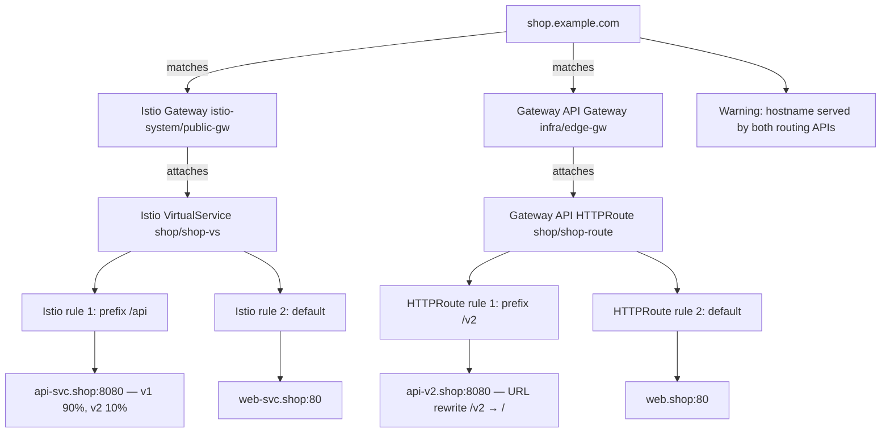

# istio-route

`istio-route` is a read-only command-line tool that traces a hostname through
Istio and Kubernetes Gateway API configuration. It shows matching entry points,
attached routes, ordered rules, destinations, and actionable findings.

For a hostname, it follows the configuration chain from Gateway/listener through
matching routes and rules to backend Services and their ready endpoints and Pods.
It can analyze either live cluster resources or local manifests, and reports
missing API families and route problems instead of silently hiding them.

## Example trace

The default text output makes the route chain and mixed routing API findings easy
to scan:

```text
shop.example.com
├─ [Istio] Gateway istio-system/public-gw server https :443 HTTPS (TLS SIMPLE, secret shop-tls)
│  └─ [Istio] VirtualService shop/shop-vs
│     ├─ [Istio] 1. prefix /api
│     │  ├─ [Istio] → api-svc.shop:8080 subset v1 (90%)
│     │  └─ [Istio] → api-svc.shop:8080 subset v2 (10%)
│     └─ [Istio] 2. (default)
│        └─ [Istio] → web-svc.shop:80 (100%)
└─ [Gateway API] Gateway infra/edge-gw listener https :443 HTTPS ✔ Programmed
   └─ [Gateway API] HTTPRoute shop/shop-route ✔ Accepted ✔ ResolvedRefs
      ├─ [Gateway API] 1. path prefix /v2 header x-canary=true
      │  ├─ [Gateway API] filter: URLRewrite path=/v2 → /
      │  └─ [Gateway API] → api-v2.shop:8080 (100%)
      └─ [Gateway API] 2. (default)
         └─ [Gateway API] → web.shop:80 (100%)
⚠ shop.example.com is served by both an Istio VirtualService and a Gateway API HTTPRoute
```

The same relationships can be rendered as a Mermaid diagram:



## Build

Requires Go 1.27 or newer.

```sh
go build -o istio-route ./cmd/istio-route
```

## Inspect offline manifests

Pass one or more files with `-f`/`--file`. Each file can contain multiple YAML
documents. Offline mode reads only those files and does not initialize a Kubernetes
client:

```sh
./istio-route -f testdata/manifests/istio.yaml shop.example.com
./istio-route -f testdata/manifests/istio.yaml \
  -f testdata/manifests/gateway-api.yaml shop.example.com
./istio-route -f testdata/manifests/mixed.yaml --output json shop.example.com
```

The examples under [`testdata/manifests/`](./testdata/manifests/) are intentionally
small and safe to inspect. `missing-reference-grant.yaml` demonstrates a rejected
cross-namespace reference; `endpoints.yaml` includes a Service, EndpointSlice, and
Pod for endpoint inspection.

## Try against a live cluster

The optional Istio demo creates a `demo.example.test` route and a small nginx
workload in the isolated `istio-route-demo` namespace:

```sh
kubectl apply -f testdata/manifests/live-demo.yaml
kubectl -n istio-route-demo rollout status deployment/demo-web
./istio-route --context docker-desktop --namespace istio-route-demo demo.example.test
./istio-route --context docker-desktop --namespace istio-route-demo \
  --output json demo.example.test
```

Replace `docker-desktop` with your kubeconfig context. The demo requires the
Istio networking API; Gateway API output is skipped if its CRDs are not installed.
It is for inspecting routing configuration, not exposing a reachable ingress.
Remove only the demo namespace when finished:

```sh
kubectl delete namespace istio-route-demo
```

## Inspect a live cluster

Without `-f`, the current kubeconfig context is used. Kubeconfig path, context, and
namespace can be selected explicitly:

```sh
./istio-route shop.example.com
./istio-route --kubeconfig ~/.kube/config --context staging \
  --namespace shop shop.example.com
```

The default namespace scope is all namespaces. If Istio or Gateway API CRDs are
unavailable, that resource family is skipped with an informational message on
stderr; available families are still analyzed.

## Output formats and color

Text is the default. Select `json`, `yaml`, or `mermaid` for machine-readable data
or a relationship diagram:

```sh
./istio-route -f testdata/manifests/mixed.yaml --output text shop.example.com
./istio-route -f testdata/manifests/mixed.yaml --output json shop.example.com
./istio-route -f testdata/manifests/mixed.yaml --output yaml shop.example.com
./istio-route -f testdata/manifests/mixed.yaml --output mermaid shop.example.com
```

Colors are used only for terminal text output. `--no-color`, `NO_COLOR`, and
redirecting stdout disable them.

## Permissions and data handling

Cluster mode is read-only. The sample
[`deploy/rbac.yaml`](./deploy/rbac.yaml) grants only `get` and `list` for the
routing resources, Services, EndpointSlices, and endpoint-target Pods used by the
tool. Bind its `istio-route-reader` ServiceAccount to your chosen namespace or
cluster context according to your organization's access policy.

The tool never reads Secret objects or Secret contents. Istio TLS certificate
references are shown by name only; they are not fetched. Offline mode reads the
manifest files supplied on the command line and makes no cluster requests.

## Exit codes

| Code | Meaning |
| --- | --- |
| `0` | Analysis succeeded and a matching route was found |
| `1` | Runtime, source, parsing, or rendering error |
| `2` | Invalid command usage |
| `3` | No supported route matched the requested hostname |

A matching route with unhealthy conditions or unresolved references is reported
with findings; it is not treated as hostname-not-found.

## Development and validation

The project uses spec-driven development. Feature requirements, design decisions,
CLI contracts, implementation tasks, and validation notes are kept under
[`specs/001-hostname-routing/`](./specs/001-hostname-routing/); the shared
templates, workflow helpers, and project principles live in [`.specify/`](./.specify/).
For a feature change, contributors can review those documents before editing,
update the relevant tasks and validation notes as implementation evolves, and keep
the runtime code organized under `cmd/` and `internal/`. These are contributor
artifacts, not runtime dependencies.

Run the local checks before opening a change:

```sh
go test -race ./...
go vet ./...
golangci-lint run
```

## Build your first release

Install GoReleaser, then validate the configuration and create a local snapshot
without publishing anything:

```sh
go install github.com/goreleaser/goreleaser/v2@latest
goreleaser check
goreleaser release --snapshot --clean
```

The snapshot artifacts are written to `dist/`. To publish the first GitHub
release, make sure the changes are pushed and CI passes, then create and push a
version tag (replace `v0.1.0` with the version you intend to release):

```sh
git tag -a v0.1.0 -m "Release v0.1.0"
git push origin v0.1.0
```

Pushing a `v*` tag triggers the release job in
[`ci.yml`](./.github/workflows/ci.yml). It builds archives for Linux, macOS, and
Windows on amd64 and arm64, creates checksums, and publishes a GitHub Release.
The workflow uses GitHub's provided token with repository contents write
permission; no personal access token is needed.
